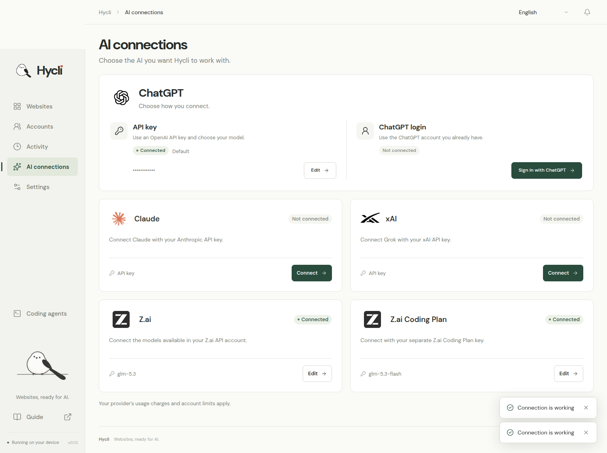
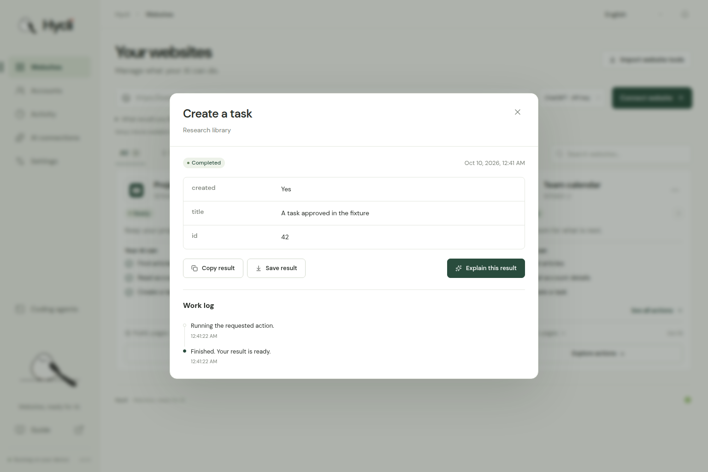

<p align="center">
  
</p>

<p align="center">
  <strong>Turn any website into a typed CLI and MCP server for your AI agent.</strong><br/>
  <sub>Read, search, create, edit, and automate—using your real browser login, with zero cookie leaks to LLMs and built-in anti-bot resilience.</sub>
</p>

<p align="center">
  <a href="https://github.com/Hybirdss/Hycli/releases/tag/v0.1.0"></a>
  <a href="LICENSE"></a>
  <a href="#use-hycli-with-your-ai"></a>
  <a href="#languages"></a>
</p>

<p align="center">
  <a href="https://github.com/Hybirdss/Hycli/releases/tag/v0.1.0">Download (Windows · macOS · Linux)</a> ·
  <a href="https://github.com/Hybirdss/Hycli/issues">Help and feedback</a> ·
  <a href="#try-it-in-30-seconds">30-second quickstart</a> ·
  <a href="#what-your-ai-can-do">What your AI can do</a> ·
  <a href="#common-concerns">Common concerns</a> ·
  <a href="#use-hycli-with-your-ai">Use with your AI</a> ·
  <a href="docs/i18n/README.ko.md">한국어</a> ·
  <a href="docs/i18n/README.ja.md">日本語</a>
</p>

<details>
<summary>Read in your language · 20 languages</summary>

[English](README.md) · [한국어](docs/i18n/README.ko.md) · [日本語](docs/i18n/README.ja.md) · [简体中文](docs/i18n/README.zh-CN.md) · [繁體中文](docs/i18n/README.zh-TW.md) · [Español](docs/i18n/README.es.md) · [Français](docs/i18n/README.fr.md) · [Deutsch](docs/i18n/README.de.md) · [Português (Brasil)](docs/i18n/README.pt-BR.md) · [Bahasa Indonesia](docs/i18n/README.id.md) · [Italiano](docs/i18n/README.it.md) · [Nederlands](docs/i18n/README.nl.md) · [Polski](docs/i18n/README.pl.md) · [Türkçe](docs/i18n/README.tr.md) · [Русский](docs/i18n/README.ru.md) · [Українська](docs/i18n/README.uk.md) · [Tiếng Việt](docs/i18n/README.vi.md) · [ไทย](docs/i18n/README.th.md) · [العربية](docs/i18n/README.ar.md) · [हिन्दी](docs/i18n/README.hi.md)

</details>

Give Hycli any website URL and what you want to do. Three AI workers inspect its docs, frontend bundles, and live browser network traffic to build a typed CLI and MCP toolset—covering both reads and writes—without ever mutating your account during setup.

<p align="center">
  
</p>
<p align="center"><sub>One local dashboard and CLI for your websites, accounts, and AI agents.</sub></p>

<a id="try-it-in-30-seconds"></a>
## Try it in 30 seconds

```sh
# 1. Point Hycli at any website and describe your goal (prepares reads & writes; zero live mutations)
hycli prepare https://your-website.example --intent "Search posts, save drafts, and publish articles"

# 2. See every prepared read, write, and multi-step workflow
hycli describe your-website

# 3. Run read actions immediately
hycli your-website search-posts --query "release notes"

# 4. Enable writes once for this CLI when you're ready to create, edit, or delete
hycli writes your-website allow
hycli your-website create-draft --title "Hello from Hycli" --body "Automated from my terminal."
```

Or connect Hycli to **Claude Code, Cursor, Codex, or Windsurf** once with `"command": "hycli", "args": ["mcp"]` and ask your agent in plain language:
> *"Use Hycli to prepare `https://...`, show me what actions are available, and draft a new post."*

<a id="get-started"></a>
## Get started

Hycli ships as a single native binary containing both the website engine and the local dashboard (`http://127.0.0.1:4318`). Neither Rust nor Node.js is needed to run a release package.

### Download and run (Windows, macOS, Linux)

Download the native installer or portable archive for your platform from **[Releases (v0.1.0)](https://github.com/Hybirdss/Hycli/releases/tag/v0.1.0)**:

| Platform | Architecture | Native Installer | Portable Archive | How to start |
| --- | --- | --- | --- | --- |
| **Windows 10/11** | x64 & ARM64 | `hycli-0.1.0-win32-*-setup.exe` | `hycli-0.1.0-win32-*.tar.gz` | Run `*-setup.exe` (adds `hycli` to your user `PATH` and Start Menu), then launch **Hycli** or run `hycli open` in PowerShell. |
| **macOS 13+** | Apple Silicon (`arm64`) & Intel (`x64`) | `hycli-0.1.0-darwin-*.dmg` | `hycli-0.1.0-darwin-*.tar.gz` | Open the `.dmg`, drag **Hycli.app** to **Applications**, and open it (automatically links `hycli` into `~/.local/bin`). |
| **Linux** | x64 & ARM64 | `hycli-0.1.0-linux-*.deb` | `hycli-0.1.0-linux-*.tar.gz` | Install the `.deb` (`sudo apt install ./hycli-*.deb`) or extract the `.tar.gz` and run `./install.sh`, then run `hycli open`. |

<details>
<summary><strong>Quick terminal install & build from source</strong></summary>

**Linux / macOS portable archive:**

```sh
sha256sum -c hycli-0.1.0-*.tar.gz.sha256   # or: shasum -a 256 -c on macOS
tar -xzf hycli-0.1.0-*.tar.gz
cd hycli-0.1.0-*
./install.sh
hycli open
```

**Windows PowerShell portable archive:**

```powershell
tar -xzf hycli-0.1.0-win32-x64.tar.gz
cd hycli-0.1.0-win32-x64
powershell -ExecutionPolicy Bypass -File .\install.ps1
hycli open
```

**Build from source (Linux, macOS, Windows):**

Install the [build prerequisites](docs/BUILD.md) and run:

```sh
node scripts/build.mjs
./dist/hycli open
```

Run `node scripts/package-desktop.mjs` to produce the native `.exe`, `.dmg`, or `.deb` installer for your OS. See [building and packaging](docs/BUILD.md) and [release verification](docs/RELEASING.md).

</details>

### Connect your first website

1. Run `hycli open` (or click the **Hycli** app icon) to open the local dashboard at `http://127.0.0.1:4318`.
2. Open **AI connections** and connect OpenAI, Anthropic Claude, xAI, Z.ai, or your local ChatGPT Codex login.
3. For logged-in sites, click **Accounts → Find my sign-in** to import your browser session into the local vault.
4. Enter a website URL and optional goal, or copy the MCP config from **Coding agents** into your AI assistant.

<a id="what-your-ai-can-do"></a>
## What your AI can do

Hycli turns real website interfaces into self-documented CLI subcommands and MCP tools:

| Website interface | Prepared capability |
| --- | --- |
| REST and OpenAPI | Typed read and write actions grounded in JSON/YAML schemas and API docs. |
| GraphQL | Parsed query and mutation documents with typed JSON variables. |
| HTML & JS-rendered pages | Structured records, links, pagination, and rendered GET reads via a local Chromium engine. |
| JSON and URL-encoded forms | Documented inputs, defaults, and account-scoped form submissions (`POST`, `PUT`, `PATCH`, `DELETE`). |

<table>
<tr><td width="50%"></td><td width="50%"></td></tr>
<tr><td align="center">Choose the AI that prepares your websites.</td><td align="center">Inspect actions and structured results locally.</td></tr>
</table>

<p align="center">
  
</p>
<p align="center"><sub>Three workers. One very busy little bird.</sub></p>

| Action type | Execution behavior |
| --- | --- |
| **Read or search** | Runs immediately when grounded in evidence and classified as a safe read. |
| **Create, send, edit, or delete** | Discovered and synthesized into the CLI without ever running during preparation. Off by default (`writes: false`). Your AI agent asks you **once per CLI** whether to enable writes (`hycli writes SITE allow` or MCP `hycli_writes`). Once enabled, write actions execute directly when you ask for them. |
| **Unclear effect** | Held for review before sending. |
| **Auth challenge or rate limit** | Switches transport strategy (HTTP → in-page `window.fetch` → stealth Chromium) or pauses cleanly. |

See the [operation reference](docs/SITESPEC.md) for supported request shapes and extraction rules.

<a id="common-concerns"></a>
## Common concerns and how Hycli solves them

Connecting an AI agent to real websites and logged-in accounts raises serious questions. Here is how Hycli handles each one by design:

### 1. "Will the AI accidentally post, edit, or delete data on my account?"
- **Zero live mutations during CLI creation:** While preparing or checking a website (`hycli prepare`, `hycli request`, `hycli recon`, `hycli check`), Hycli discovers and compiles both read and write operations into the CLI spec, but **never executes write requests**. Even disguised mutations (`GET` routes with mutating paths like `/delete`, GraphQL `mutation` bodies, or HTML `<form method="post">` actions) are blocked from running during verification.
- **One-time per-CLI write confirmation:** Every newly created website CLI starts with `writes: false`. When an AI agent needs to run a write action on a CLI for the first time, it asks you **once for that CLI**: *"Allow write actions for `<site>`?"* Only after you confirm does it run `hycli writes <site> allow` (or MCP `hycli_writes`), enabling direct write execution for that CLI. You can revoke write permission anytime with `hycli writes <site> deny` or the dashboard's **Allow changes** toggle.
- **No automatic write retries:** Failed or interrupted write requests are never auto-retried. If a connection drops after a mutation is sent, Hycli reports `action_outcome_unknown` so you can check the website rather than duplicating an order or post.

### 2. "Does Hycli send my cookies, login tokens, or API keys to the AI model?"
- **Secrets never enter LLM prompts:** Browser cookies, `localStorage` / `sessionStorage` tokens, and API keys are stored strictly in your local vault (encrypted via OS keyring on Windows Credential Manager, macOS Keychain, and Linux Secret Service, or restricted to `0600` user-only permissions).
- **Symbolic connection recipes:** AI models only see account labels, storage key names, and redacted response schemas. The model builds a symbolic `ConnectionRecipe` (referencing a cookie or token name), and Hycli injects the real secret locally at execution time while scrubbing secrets from all outputs and logs.
- **Site-scoped read-only import:** Importing a browser session reads only the target domain's cookies and storage from a temporary read-only snapshot. It never weakens browser security or exports other websites.

### 3. "Will scraping trigger CAPTCHAs or get my account banned?"
- **No fuzzing or brute-force scanning:** Hycli never guesses endpoint wordlists or fuzzes live servers. It learns from linked documentation, OpenAPI/GraphQL schemas, static JS bundles, and observed browser network shapes.
- **Serialized, paced traffic:** Requests are serialized and rate-limited per website and per account, honoring `Retry-After` and bounding read retries.
- **Strategy circuit breaker & native browser execution:** When plain HTTP hits a 403/429 or bot challenge (Cloudflare, Akamai Bot Manager), Hycli never loops the same blocked request. Its circuit breaker immediately switches transport—executing `window.fetch(..., { credentials: 'include' })` inside your authenticated browser context or using a local stealth Chromium engine—or pauses cleanly to protect your account.

### 4. "Can a redirect leak my session, or can a shared spec expose my computer's paths?"
- **Strict origin binding:** Auth headers and cookies are locked to the target origin and stripped immediately on cross-origin redirects. Private and loopback IP ranges are blocked by default unless `--allow-local` is explicitly passed.
- **Portable specs:** Local browser executable and profile paths remain in machine-local state and are never written into portable `SiteSpec` files.

### 5. "Will the AI waste tokens retrying when my login expires?"
- **Deterministic health check without AI (`hycli check`):** `hycli check` (and MCP `hycli_check`) replays verified read chains without invoking an LLM and cleanly separates `signed_out` (reconnect your account) from `site_changed` (repair spec), `blocked`, and `unreachable`.

<a id="ai-connections"></a>
## AI connections

| Provider | Authentication |
| --- | --- |
| ChatGPT · API key | OpenAI API key |
| Claude | Anthropic API key |
| xAI | xAI API key |
| Z.ai / Z.ai Coding Plan | Z.ai API key |
| ChatGPT · login | Local ChatGPT sign-in via the official Codex app-server protocol |

The Codex login connection runs in an ephemeral thread with file, shell, browser, and external MCP execution disabled; Hycli never reads or copies Codex OAuth tokens.

<a id="use-hycli-with-your-ai"></a>
## Use Hycli with your AI

Add Hycli to your MCP client (**Coding agents → View connection settings** shows the exact path for your OS):

```json
{
  "mcpServers": {
    "hycli": {
      "command": "hycli",
      "args": ["mcp"]
    }
  }
}
```

Use `hycli mcp --sites-only` to expose only installed website tools, or add `--only-site SITE` to scope to a single site. The MCP server provides `hycli_prepare`, `hycli_writes` (enables writes once per CLI after asking you), `hycli_run`, `hycli_check`, `hycli_result`, and `hycli_activity`—and never exposes a tool for reading credentials.

From the terminal, every workflow works the same way:

```sh
hycli prepare https://your-website.example --intent "Find saved references"
hycli request SITE "Add draft editing and publishing with full post content"
hycli describe SITE
hycli SITE ACTION --help
hycli writes SITE allow
hycli SITE ACTION --query "design systems"
hycli check SITE
```

See the [Hycli skill](skills/hycli/SKILL.md) and [agent guide](agent/AGENTS.md) (`CLAUDE.md`) for how coding agents discover capabilities, summarize available read/write actions for you, ask once per CLI before enabling writes, and recover from failures.

<a id="browser-sign-in"></a>
## Browser sign-in

Hycli discovers local Chrome, Chromium, Edge, Brave, Vivaldi, Arc, Whale, and Firefox profiles (plus local stealth Chromium binaries when installed) on Windows, macOS, and Linux, importing only the requested website's session into the local vault. Profiles sharing the same verified website account are deduplicated automatically.

If a session is locked by Windows App-Bound encryption, private containers, or an unimported browser, use **Accounts → Connect an account** to sign in via your browser, connect the [browser companion extension](browser-companion/guide.html), or import a JSON/Netscape cookie file in the dashboard (never paste cookies into an AI chat).

<a id="languages"></a>
## Languages

The dashboard and AI-generated action descriptions support the 20 languages linked at the top of this README, including right-to-left Arabic.

<a id="local-data"></a>
## Local data and request limits

Website definitions, encrypted credentials, and activity logs live in your OS data directory (`%LOCALAPPDATA%\hycli` on Windows, `~/Library/Application Support/hycli` on macOS, `~/.local/share/hycli` on Linux, or `HYCLI_DATA_DIR`). Inspect active vault protection anytime under **Settings**.

<a id="contributing"></a>
## Development and verification

See [CONTRIBUTING.md](CONTRIBUTING.md) and [CHANGELOG.md](CHANGELOG.md). Run the full verification suite locally with:

```sh
npm --prefix dashboard ci
npm --prefix dashboard run check
npm --prefix dashboard run build
cargo test --all-targets --locked
cargo build --locked --bin hycli --example dashboard_fixture
node scripts/test-e2e.mjs --full
```

All tests run against synthetic local websites and fixtures—never test write operations against a real third-party account.

## Community

For setup questions and ideas, [open an issue](https://github.com/Hybirdss/Hycli/issues). Use the [issue templates](https://github.com/Hybirdss/Hycli/issues/new/choose) to report a reproducible bug or request an improvement.

`hycli feedback` requests a browser to open a generic issue editor with the Hycli version and platform in the title and body. It always returns JSON containing `url` and `launch_requested`; the latter only says whether the browser launcher started, not whether a page opened. If no page opens, open the returned URL yourself. The command exits successfully even without a launcher.

No issue is submitted automatically. Opening the URL contacts GitHub and sends the version and platform in the URL, along with ordinary browser request metadata. Review the public issue before submitting and remove credentials, cookies, account details and private website data.

## License and intended use

Hycli is licensed under [Apache-2.0](LICENSE). Use it only with websites and accounts you are authorized to access. Provided "as is" without warranty; the authors and contributors are not liable for any losses, account restrictions, or bans resulting from its use.

## Star History

<a href="https://www.star-history.com/#Hybirdss/Hycli&Date">
 <picture>
   <source media="(prefers-color-scheme: dark)" srcset="https://api.star-history.com/svg?repos=Hybirdss/Hycli&type=Date&theme=dark" />
   <source media="(prefers-color-scheme: light)" srcset="https://api.star-history.com/svg?repos=Hybirdss/Hycli&type=Date" />
   
 </picture>
</a>
