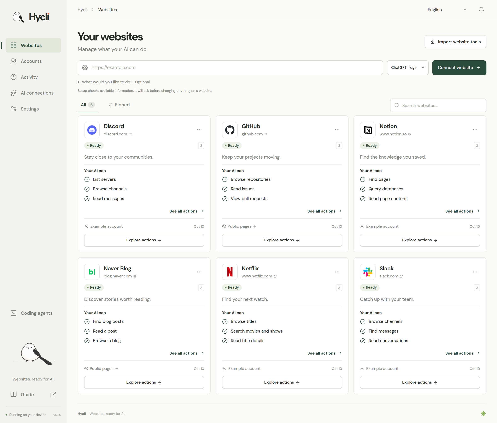
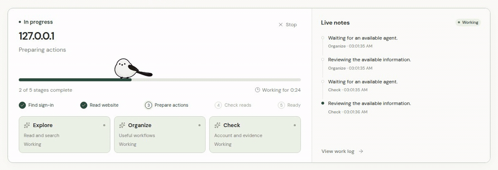

<p align="center">
  
</p>

<p align="center">
  <strong>Ubah situs web apa pun menjadi alat CLI dan server MCP bertipe untuk agen AI dan terminal Anda.</strong><br/>
  <sub>Baca, cari, buat, edit, dan otomatiskan—menggunakan sesi login peramban asli Anda, tanpa kebocoran cookie ke LLM dan dilengkapi ketahanan anti-bot bawaan.</sub>
</p>

<p align="center">
  <a href="https://github.com/Hybirdss/Hycli/releases/tag/v0.1.0">Unduh (Windows · macOS · Linux)</a> ·
  <a href="https://github.com/Hybirdss/Hycli/issues">Dapatkan bantuan di GitHub</a> ·
  <a href="#try-it-in-30-seconds">Coba dalam 30 detik</a> ·
  <a href="#get-started">Mulai</a> ·
  <a href="#what-your-ai-can-do">Apa yang dapat dilakukan AI Anda</a> ·
  <a href="#common-concerns">Kekhawatiran umum</a> ·
  <a href="#use-hycli-with-your-ai">Gunakan dengan AI</a>
</p>

<details>
<summary>Baca dalam bahasa Anda · 20 bahasa</summary>

[English](../../README.md) · [한국어](README.ko.md) · [日本語](README.ja.md) · [简体中文](README.zh-CN.md) · [繁體中文](README.zh-TW.md) · [Español](README.es.md) · [Français](README.fr.md) · [Deutsch](README.de.md) · [Português (Brasil)](README.pt-BR.md) · [Bahasa Indonesia](README.id.md) · [Italiano](README.it.md) · [Nederlands](README.nl.md) · [Polski](README.pl.md) · [Türkçe](README.tr.md) · [Русский](README.ru.md) · [Українська](README.uk.md) · [Tiếng Việt](README.vi.md) · [ไทย](README.th.md) · [العربية](README.ar.md) · [हिन्दी](README.hi.md)

</details>

Berikan URL situs web apa pun beserta tujuan yang ingin Anda lakukan kepada Hycli. Tiga pekerja AI akan memeriksa dokumentasi, bundel JS frontend, dan lalu lintas jaringan peramban langsung untuk membangun perangkat CLI dan MCP bertipe—mencakup operasi baca maupun tulis—tanpa pernah mengirimkan perubahan apa pun ke akun asli Anda selama persiapan.

<p align="center">
  
</p>
<p align="center"><sub>Kelola situs web, akun, izin tulis, dan hasil eksekusi dalam satu dasbor lokal dan CLI.</sub></p>

<a id="try-it-in-30-seconds"></a>
## Coba dalam 30 detik

```sh
# 1. Arahkan Hycli ke situs web mana pun dan jelaskan tujuan Anda (menyiapkan baca & tulis; nol perubahan langsung saat persiapan)
hycli prepare https://your-website.example --intent "Cari postingan, simpan draf, dan terbitkan artikel"

# 2. Lihat semua perintah baca, tulis, dan alur kerja multi-langkah yang telah disiapkan
hycli describe your-website

# 3. Jalankan tindakan baca dan pencarian secara langsung
hycli your-website search-posts --query "catatan rilis"

# 4. Aktifkan izin tulis cukup sekali untuk CLI ini saat Anda siap membuat, mengedit, atau menghapus
hycli writes your-website allow
hycli your-website create-draft --title "Halo dari Hycli" --body "Diotomatiskan langsung dari terminal saya."
```

Atau hubungkan Hycli ke **Claude Code, Cursor, Codex, atau Windsurf** cukup sekali dengan `"command": "hycli", "args": ["mcp"]` lalu minta agen Anda menggunakan bahasa sehari-hari:
> *"Gunakan Hycli untuk menyiapkan `https://...`, tunjukkan tindakan apa saja yang tersedia, lalu buatkan draf postingan baru."*

<a id="get-started"></a>
## Mulai

Hycli dikemas sebagai satu berkas biner native tunggal yang berisi mesin situs web sekaligus dasbor lokal (`http://127.0.0.1:4318`). Anda tidak memerlukan Rust maupun Node.js untuk menjalankan paket rilis.

### Unduh dan jalankan (Windows, macOS, Linux)

Unduh pemasang native atau arsip portabel untuk platform Anda dari **[GitHub Releases (v0.1.0)](https://github.com/Hybirdss/Hycli/releases/tag/v0.1.0)**:

| Sistem Operasi | Arsitektur | Pemasang Native | Arsip Portabel | Cara memulai |
| --- | --- | --- | --- | --- |
| **Windows 10/11** | x64 & ARM64 | `hycli-0.1.0-win32-*-setup.exe` | `hycli-0.1.0-win32-*.tar.gz` | Jalankan `*-setup.exe` (tanpa hak admin, otomatis menambahkan `hycli` ke `PATH` pengguna dan Start Menu), lalu buka **Hycli** atau jalankan `hycli open` di PowerShell |
| **macOS 13+** | Apple Silicon (`arm64`) & Intel (`x64`) | `hycli-0.1.0-darwin-*.dmg` | `hycli-0.1.0-darwin-*.tar.gz` | Buka `.dmg`, seret **Hycli.app** ke **Applications**, lalu jalankan (otomatis menautkan `~/.local/bin/hycli`) |
| **Linux** | x64 & ARM64 | `hycli-0.1.0-linux-*.deb` | `hycli-0.1.0-linux-*.tar.gz` | Pasang `.deb` (`sudo apt install ./hycli-*.deb`) atau ekstrak `.tar.gz` dan jalankan `./install.sh`, lalu jalankan `hycli open` |

<details>
<summary><strong>Pemasangan portabel via terminal & bangun dari kode sumber</strong></summary>

**Arsip portabel Linux / macOS:**

```sh
sha256sum -c hycli-0.1.0-*.tar.gz.sha256   # atau di macOS: shasum -a 256 -c
tar -xzf hycli-0.1.0-*.tar.gz
cd hycli-0.1.0-*
./install.sh
hycli open
```

**Arsip portabel Windows PowerShell:**

```powershell
tar -xzf hycli-0.1.0-win32-x64.tar.gz
cd hycli-0.1.0-win32-x64
powershell -ExecutionPolicy Bypass -File .\install.ps1
hycli open
```

**Bangun dari kode sumber (Linux, macOS, Windows):**

Pasang [prasyarat build](../BUILD.md) lalu jalankan:

```sh
node scripts/build.mjs
./dist/hycli open
```

Jalankan `node scripts/package-desktop.mjs` untuk menghasilkan pemasang native `.exe`, `.dmg`, atau `.deb` bagi OS Anda. Lihat [panduan build dan pemaketan](../BUILD.md) serta [verifikasi rilis](../RELEASING.md).

</details>

### Hubungkan situs web pertama Anda

1. Jalankan `hycli open` (atau klik ikon aplikasi **Hycli**) untuk membuka dasbor lokal di `http://127.0.0.1:4318`.
2. Buka **Koneksi AI** dan hubungkan OpenAI, Anthropic Claude, xAI, Z.ai, atau login ChatGPT (Codex) lokal Anda.
3. Untuk situs yang memerlukan login, klik **Akun → Temukan login saya** guna mengimpor sesi peramban ke dalam brankas terenkripsi lokal.
4. Masukkan URL situs web dan tujuan opsional untuk membuat alat, atau salin konfigurasi MCP dari **Agen pemrograman** ke asisten AI Anda.

<a id="what-your-ai-can-do"></a>
## Apa yang dapat dilakukan AI Anda

Hycli mengubah antarmuka situs web nyata menjadi subperintah CLI dan alat MCP yang terdokumentasi otomatis:

| Antarmuka situs web | Kemampuan yang disiapkan |
| --- | --- |
| REST dan OpenAPI | Tindakan baca dan tulis bertipe berdasarkan skema JSON/YAML dan dokumentasi API. |
| GraphQL | Dokumen kueri dan mutasi terurai dengan variabel JSON bertipe. |
| Halaman HTML & yang dirender JS | Ekstraksi daftar rekaman, tautan, paginasi berbasis selektor yang diamati, serta pembacaan halaman GET yang dirender melalui mesin Chromium lokal. |
| Formulir JSON dan URL-encoded | Masukan terdokumentasi, nilai bawaan, dan pengiriman formulir terikat akun (`POST`, `PUT`, `PATCH`, `DELETE`). |

<p align="center">
  
</p>
<p align="center"><sub>Tiga pekerja. Seekor burung kecil yang sangat sibuk.</sub></p>

| Jenis tindakan | Perilaku eksekusi |
| --- | --- |
| **Baca atau cari** | Berjalan seketika saat didukung bukti dan diklasifikasikan sebagai operasi baca yang aman. |
| **Buat, kirim, edit, atau hapus** | Ditemukan dan disintesiskan ke dalam spesifikasi CLI tanpa pernah dijalankan selama persiapan atau pemeriksaan. Nonaktif secara bawaan (`writes: false`). Agen AI Anda akan bertanya **sekali per CLI** apakah Anda mengizinkan operasi tulis (`hycli writes SITE allow` atau MCP `hycli_writes`). Setelah diaktifkan, tindakan tulis langsung dijalankan saat Anda memintanya. |
| **Dampak tidak jelas** | Ditahan untuk ditinjau sebelum dikirim. |
| **Tantangan autentikasi atau batas laju** | Beralih strategi transpor secara langsung (HTTP → `window.fetch` dalam halaman → Chromium siluman) atau menjeda dengan aman. |

Lihat [referensi operasi](../SITESPEC.md) untuk bentuk permintaan dan aturan ekstraksi yang didukung.

<a id="common-concerns"></a>
## Kekhawatiran umum dan cara Hycli mengatasinya

Menghubungkan agen AI ke situs web nyata dan akun yang sedang login menimbulkan pertanyaan serius. Berikut cara Hycli menangani masing-masing masalah tersebut melalui rancangannya:

### 1. "Apakah AI akan secara tidak sengaja memposting, mengedit, atau menghapus data di akun saya?"
- **Nol perubahan langsung selama pembuatan dan pemeriksaan CLI:** Saat menyiapkan atau memeriksa situs web (`hycli prepare`, `hycli request`, `hycli recon`, `hycli check`), Hycli menemukan dan mengompilasi operasi baca maupun tulis ke dalam spesifikasi CLI, tetapi **tidak pernah mengeksekusi permintaan tulis**. Bahkan mutasi yang tersamar (rute `GET` dengan jalur pengubah seperti `/delete`, isi `mutation` GraphQL, atau pengiriman HTML `<form method="post">`) diblokir agar tidak berjalan selama verifikasi.
- **Konfirmasi izin tulis satu kali per CLI:** Setiap CLI situs web yang baru dibuat dimulai dengan `writes: false`. Ketika agen AI perlu menjalankan tindakan tulis pada suatu CLI untuk pertama kalinya, ia akan bertanya kepada Anda **sekali untuk CLI tersebut**: *"Izinkan tindakan tulis untuk `<site>`?"* Hanya setelah Anda mengonfirmasi, ia akan menjalankan `hycli writes <site> allow` (atau MCP `hycli_writes`) sehingga eksekusi tulis langsung aktif untuk CLI tersebut. Anda dapat mencabut izin tulis kapan saja dengan `hycli writes <site> deny` atau sakelar **Izinkan perubahan** di dasbor.
- **Tidak ada percobaan ulang otomatis untuk operasi tulis:** Permintaan tulis yang gagal atau terputus tidak pernah dicoba ulang secara otomatis. Jika koneksi terputus setelah mutasi dikirim, Hycli melaporkan `action_outcome_unknown` agar Anda dapat memeriksa situs web terlebih dahulu alih-alih menggandakan pesanan atau postingan.

### 2. "Apakah Hycli mengirimkan cookie, token login, atau kunci API saya ke model AI (LLM)?"
- **Rahasia tidak pernah masuk ke prompt LLM:** Cookie peramban, token `localStorage` / `sessionStorage`, dan kunci API disimpan secara ketat di dalam brankas lokal Anda (dienkripsi melalui keyring OS pada Windows Credential Manager, macOS Keychain, dan Linux Secret Service, atau dibatasi dengan izin `0600` khusus pengguna saat ini).
- **Resep koneksi simbolis (`ConnectionRecipe`):** Model AI hanya melihat label akun, nama kunci penyimpanan, dan skema respons yang telah disensor. Model menyusun `ConnectionRecipe` simbolis (merujuk pada nama cookie atau token), lalu Hycli menyuntikkan nilai rahasia sebenarnya secara lokal saat waktu eksekusi sembari membersihkan rahasia dari semua keluaran dan log.
- **Impor hanya-baca khusus situs:** Mengimpor sesi peramban hanya membaca cookie dan penyimpanan milik domain target dari snapshot hanya-baca sementara. Proses ini tidak pernah memperlemah keamanan peramban atau mengekspor data situs web lain.

### 3. "Apakah pengambilan data akan memicu CAPTCHA atau membuat akun saya diblokir?"
- **Tanpa fuzzing atau pemindaian brute-force:** Hycli tidak pernah menebak daftar kata endpoint atau melakukan fuzzing terhadap server aktif. Ia belajar dari dokumentasi tertaut, skema OpenAPI/GraphQL, bundel JS statis, dan pola jaringan peramban yang diamati.
- **Lalu lintas berurutan dengan pengaturan jeda:** Permintaan dijalankan secara berurutan dan dibatasi lajunya per situs web dan per akun, mematuhi header `Retry-After` serta membatasi jumlah percobaan ulang pembacaan dan ukuran respons.
- **Pemutus sirkuit strategi & eksekusi peramban asli:** Ketika permintaan HTTP biasa terkena 403/429 atau tantangan bot (Cloudflare, Akamai Bot Manager), Hycli tidak pernah mengulang permintaan yang diblokir secara terus-menerus. Pemutus sirkuitnya segera mengalihkan transpor—menjalankan `window.fetch(..., { credentials: 'include' })` di dalam konteks peramban Anda yang sudah terautentikasi atau menggunakan mesin Chromium siluman lokal—atau menjeda dengan aman demi melindungi akun Anda.

### 4. "Dapatkah pengalihan (redirect) membocorkan sesi saya, atau dapatkah spesifikasi yang dibagikan mengekspos jalur komputer saya?"
- **Pengikatan origin yang ketat:** Header autentikasi dan cookie dikunci pada origin target dan langsung dihapus saat terjadi pengalihan lintas-origin. Rentang IP privat dan loopback diblokir secara bawaan kecuali `--allow-local` diberikan secara eksplisit.
- **Spesifikasi portabel:** Jalur berkas eksekusi peramban dan profil lokal tetap tersimpan di dalam status khusus mesin dan tidak pernah ditulis ke dalam berkas `SiteSpec` portabel.

### 5. "Apakah AI akan membuang-buang token dengan terus mencoba ulang saat login saya kedaluwarsa?"
- **Pemeriksaan kesehatan deterministik tanpa AI (`hycli check`):** `hycli check` (dan MCP `hycli_check`) memutar ulang rantai pembacaan terverifikasi tanpa memanggil LLM dan memisahkan secara jelas antara `signed_out` (hubungkan ulang akun Anda) dengan `site_changed` (perbaiki spesifikasi), `blocked`, dan `unreachable`.

<a id="ai-connections"></a>
## Koneksi AI

| Penyedia | Autentikasi |
| --- | --- |
| ChatGPT · API key | Kunci API OpenAI |
| Claude | Kunci API Anthropic |
| xAI | Kunci API xAI |
| Z.ai / Z.ai Coding Plan | Kunci API Z.ai |
| ChatGPT · login | Login ChatGPT lokal melalui protokol resmi Codex app-server |

Koneksi login Codex berjalan dalam thread sementara dengan eksekusi berkas, shell, peramban, dan MCP eksternal dinonaktifkan; Hycli tidak pernah membaca atau menyalin token OAuth Codex.

<a id="use-hycli-with-your-ai"></a>
## Gunakan Hycli dengan AI Anda

Tambahkan Hycli ke klien MCP Anda (**Agen pemrograman → Lihat pengaturan koneksi** menampilkan jalur tepat untuk OS Anda):

```json
{
  "mcpServers": {
    "hycli": {
      "command": "hycli",
      "args": ["mcp"]
    }
  }
}
```

Gunakan `hycli mcp --sites-only` untuk menampilkan alat situs web yang sudah terpasang saja, atau tambahkan `--only-site SITE` untuk membatasi ke satu situs. Server MCP menyediakan `hycli_prepare`, `hycli_writes` (mengaktifkan izin tulis sekali per CLI setelah bertanya kepada Anda), `hycli_run`, `hycli_check`, `hycli_result`, dan `hycli_activity`—serta tidak pernah menyediakan alat untuk membaca kredensial.

Dari terminal, setiap alur kerja bekerja dengan cara yang sama:

```sh
hycli prepare https://your-website.example --intent "Temukan referensi yang disimpan"
hycli request SITE "Tambahkan pengeditan isi draf, penyimpanan draf, dan penerbitan artikel"
hycli describe SITE
hycli SITE ACTION --help
hycli writes SITE allow
hycli SITE ACTION --query "design systems"
hycli check SITE
```

[Panduan agen](../../agent/AGENTS.md) · [Skill Hycli](../../skills/hycli/SKILL.md)

<a id="browser-sign-in"></a>
## Masuk melalui peramban

Hycli menemukan profil Chrome, Chromium, Edge, Brave, Vivaldi, Arc, Whale, dan Firefox lokal (beserta biner Chromium siluman lokal jika terpasang) di Windows, macOS, dan Linux, serta hanya mengimpor sesi situs web yang diminta ke dalam brankas lokal. Profil yang berbagi akun situs web terverifikasi yang sama akan digabungkan secara otomatis.

Jika sesi dikunci oleh enkripsi Windows App-Bound, container privat, atau peramban yang belum diimpor, gunakan **Akun → Hubungkan akun** untuk masuk melalui peramban Anda, hubungkan [ekstensi pendamping peramban](../../browser-companion/guide.html), atau impor berkas cookie JSON/Netscape di dasbor (jangan pernah menempelkan cookie ke dalam obrolan AI).

<a id="languages"></a>
## Bahasa

Dasbor dan deskripsi tindakan yang dihasilkan AI mendukung 20 bahasa yang ditautkan di bagian atas README ini, termasuk bahasa Arab yang ditulis dari kanan ke kiri (RTL).

<a id="local-data"></a>
## Data lokal dan batas permintaan

Definisi situs web, kredensial terenkripsi, dan log aktivitas disimpan di direktori data OS Anda (`%LOCALAPPDATA%\hycli` di Windows, `~/Library/Application Support/hycli` di macOS, `~/.local/share/hycli` di Linux, atau `HYCLI_DATA_DIR`). Periksa jalur aktif dan perlindungan brankas kapan saja melalui **Pengaturan**.

<a id="contributing"></a>
## Pengembangan dan verifikasi

```sh
npm --prefix dashboard ci
npm --prefix dashboard run check
npm --prefix dashboard run build
cargo test --all-targets --locked
cargo build --locked --bin hycli --example dashboard_fixture
node scripts/test-e2e.mjs --full
```

Semua pengujian dijalankan terhadap situs web lokal sintetis dan fixture—jangan pernah menguji operasi tulis terhadap akun pihak ketiga yang nyata. Lihat [sumber visual](../images/README.md).

## Lisensi dan tujuan penggunaan

Hycli dilisensikan di bawah [Apache-2.0](../../LICENSE). Gunakan hanya pada situs web dan akun yang berhak Anda akses. Disediakan "sebagaimana adanya" tanpa jaminan; penulis dan kontributor tidak bertanggung jawab atas segala kerugian, pembatasan akun, atau pemblokiran yang timbul akibat penggunaannya.

## Star History

<a href="https://www.star-history.com/#Hybirdss/Hycli&Date">
 <picture>
   <source media="(prefers-color-scheme: dark)" srcset="https://api.star-history.com/svg?repos=Hybirdss/Hycli&type=Date&theme=dark" />
   <source media="(prefers-color-scheme: light)" srcset="https://api.star-history.com/svg?repos=Hybirdss/Hycli&type=Date" />
   
 </picture>
</a>
